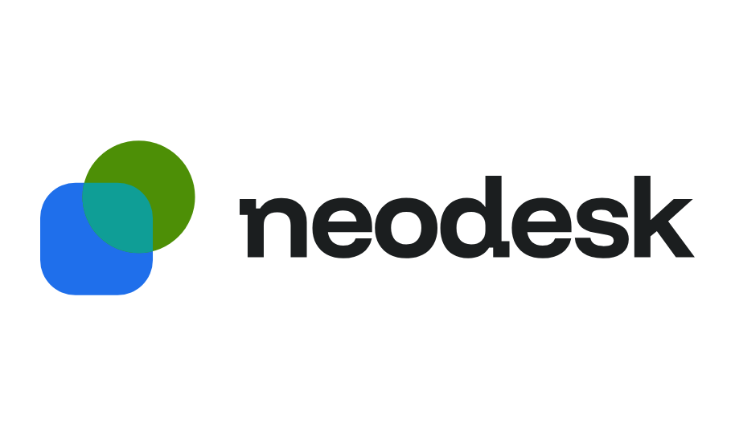

# NeoDesk Client

<div align="center">

<picture>
  <source media="(prefers-color-scheme: dark)" srcset="flutter/assets/nd-logo-dark.svg">
  <source media="(prefers-color-scheme: light)" srcset="flutter/assets/nd-logo-light.svg">
  
</picture>

<br><br>


NeoDesk is a fork of [RustDesk](https://github.com/rustdesk/rustdesk). Licensed under **AGPL-3.0**.

</div>

---

> [!Caution]
> **Misuse Disclaimer:** The developers of this software do not condone or support any unethical or illegal use. Misuse, such as unauthorized access, control or invasion of privacy, is strictly against our guidelines. The authors are not responsible for any misuse of the application.

This repository is the **official NeoDesk desktop client** ([neodeskapp/neodesk-client](https://github.com/neodeskapp/neodesk-client)). Active work targets **Flutter desktop on Windows and Linux**. Mobile and web trees remain in-repo but are not the current focus.

> **AI-assisted development:** NeoDesk Client is created and maintained with the assistance of artificial intelligence tools.

The client **does not** connect to public `*.rustdesk.com` infrastructure. Configure your own ID / Relay / API / Key (Settings → Network), import a deploy string from the NeoDesk panel, or use a Generator bake-in (`custom.txt`). Without a configured server, the client does not register on a public cloud.

Pair it with the self-hosted NeoDesk server and web console: [neodeskapp/neodesk](https://github.com/neodeskapp/neodesk).

---

## Product SKUs

| SKU | Role |
|-----|------|
| **NeoDesk Client** | Full desktop client (outbound + inbound) |
| **NeoDesk Support Agent** | Incoming-only agent (Generator bake-in; no outbound remote control) |

Both identify to the API as `neodesk-desktop` with a distinct `product_sku`.

---

## Documentation

| Topic | Doc |
|-------|-----|
| Desktop build (Windows / Linux Flutter) | [docs/BUILD_DESKTOP.md](docs/BUILD_DESKTOP.md) |
| NeoDesk server docs | [neode.sk/docs](https://neode.sk/docs) |

---

## Build (desktop)

Full steps, tool versions, and smoke-build commands: **[docs/BUILD_DESKTOP.md](docs/BUILD_DESKTOP.md)**.

Short checklist:

1. Init the required submodule:
   ```sh
   git submodule update --init --recursive
   ```
2. Install the toolchain pinned in that guide (Flutter **3.24.5**, Rust **1.75**, vcpkg, LLVM/Clang as needed).
3. On Windows, optionally activate/check the env:
   ```powershell
   . .\scripts\activate_desktop_env_windows.ps1
   powershell -ExecutionPolicy Bypass -File .\scripts\check_desktop_env_windows.ps1
   ```
4. Build the Flutter desktop app for Windows or Linux per `BUILD_DESKTOP.md`.

---

## Repository layout

- **`src/`** — Rust application (server services, client connection, platform code)
- **`src/server/`** — audio / clipboard / input / video / network services
- **`src/platform/`** — platform-specific code
- **`flutter/`** — Flutter UI (desktop under `flutter/lib/desktop/`)
- **`libs/hbb_common/`** — config, protobuf, shared utilities (git submodule)
- **`libs/scrap/`** — screen capture
- **`libs/enigo/`** — input control
- **`libs/clipboard/`** — clipboard / file copy-paste
- **`res/neodesk/`** — Generator signing keys and notes for `custom.txt`

---

## Attribution and license

NeoDesk Client is a modified version of [RustDesk](https://github.com/rustdesk/rustdesk), copyright Purslane Ltd. and the RustDesk contributors, and includes work from BetterDesk-Client by UNITRONIX. Both are licensed under the AGPL-3.0, and so is NeoDesk Client (see [LICENCE](LICENCE)). The About page and the system information keep the RustDesk credit and the links to the source code.

The language flags in `flutter/assets/flags` are from [Twemoji](https://github.com/jdecked/twemoji) (`@twemoji/svg` 15.0.0), licensed under [CC-BY 4.0](https://creativecommons.org/licenses/by/4.0/).

---

## Support

- [NeoDesk issues](https://github.com/neodeskapp/neodesk/issues)
- [NeoDesk Client issues](https://github.com/neodeskapp/neodesk-client/issues)
