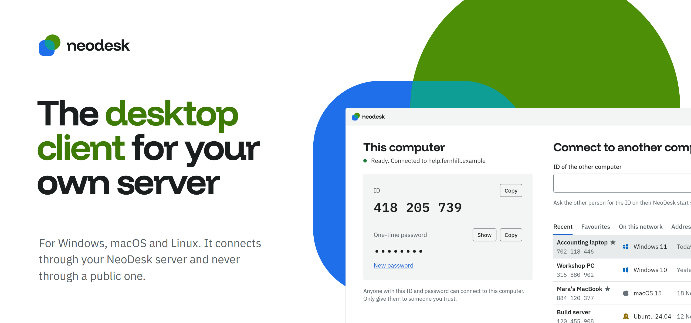
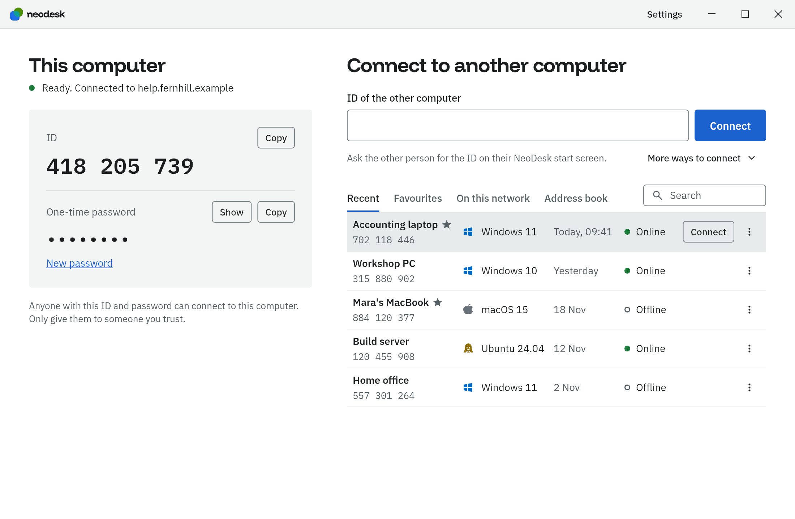
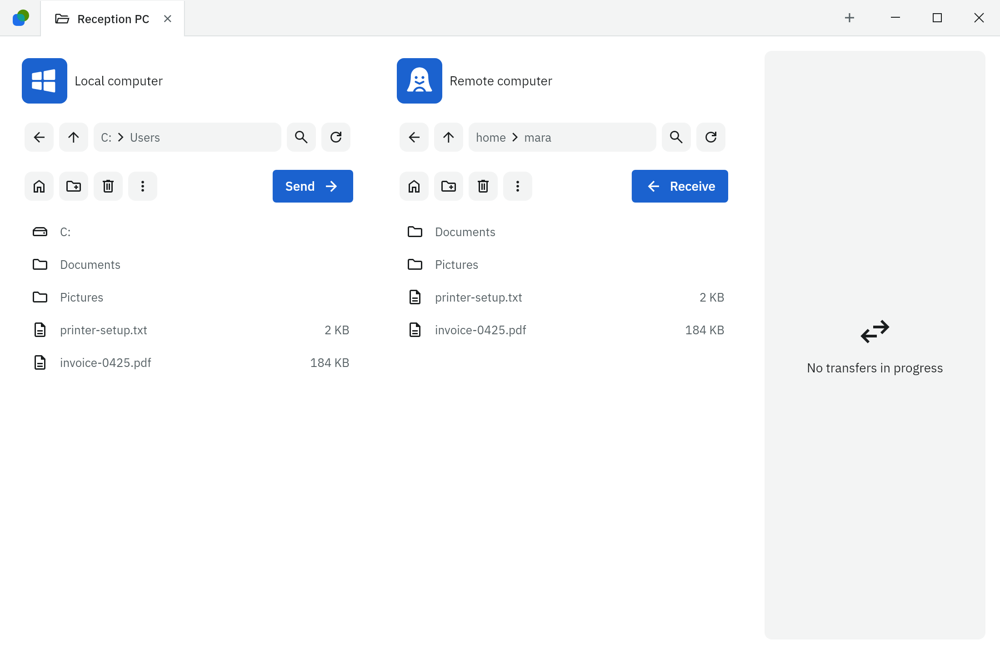

<p align="center">
  <a href="https://neode.sk">
    <picture>
      <source media="(prefers-color-scheme: dark)" srcset="docs/assets/readme/hero-dark.png">
      
    </picture>
  </a>
</p>

<p align="center">
  <a href="https://github.com/neodeskapp/neodesk-client/releases"><picture><source media="(prefers-color-scheme: dark)" srcset="docs/assets/badges/dark/version.svg"></picture></a>
  <a href="LICENCE"><picture><source media="(prefers-color-scheme: dark)" srcset="docs/assets/badges/dark/license.svg"></picture></a>
  <a href="#download-and-install"><picture><source media="(prefers-color-scheme: dark)" srcset="docs/assets/badges/dark/platforms.svg"></picture></a>
  <a href="https://docs.neode.sk"><picture><source media="(prefers-color-scheme: dark)" srcset="docs/assets/badges/dark/docs.svg"></picture></a>
</p>

NeoDesk is the desktop client for [NeoDesk](https://github.com/neodeskapp/neodesk),
the remote desktop server you run yourself. It runs on Windows, macOS and Linux
and is a fork of [RustDesk](https://github.com/rustdesk/rustdesk). It has no
public server built in: until an invite, a pairing code or its settings give it
your server, it connects to no server at all.

Getting help: ask on the [NeoDesk Discord](https://discord.gg/nwERSawufr) or in
[GitHub Discussions](https://github.com/neodeskapp/neodesk/discussions).

| <picture><source media="(prefers-color-scheme: dark)" srcset="docs/assets/readme/screen-home-dark.png"></picture> |
|---|
| Home, with example data |

## What it does

- **Join your server with an invite:** an invite link from the console's
  **Add a computer** installs NeoDesk and joins the computer, already approved
  and in its folder. On a computer that has NeoDesk, type the invite's code in
  **Settings**, **Server**, **Join a server**. **Pair with code** and
  **Set up by hand** are on the same page.
- **Connect to another computer:** by its ID, or from **Recent**,
  **Favourites**, **On this network** and **Address book** on Home. A session
  has the keyboard, files, chat and full screen in its bar, and the client
  also opens a terminal or a TCP tunnel to the other computer.
- **Quick support:** a link from the console gives the person a small
  NeoDesk Quick Support app. They click **Allow**, you connect without an ID or
  a password, and nothing gets installed.
- **Unattended access:** installed with its service, NeoDesk takes connections
  when nobody is at the computer, with a permanent password set in
  **Settings**, **Security**.
- **Sign in at the Windows lock screen:** when a Windows account is saved for
  the computer in the console, the console's browser viewer signs in at the
  lock screen through NeoDesk's service.
- **Your account and address book:** sign in with your account on the server
  to get your address book and the contacts your organization shares.
- **Pause connections:** on Windows and Linux, **Stop accepting connections**
  in the tray pauses all connections and keeps NeoDesk installed.
  **Accept connections** turns them back on.
- **Made for your console:** the client sends the server its hardware and
  system information for the device's page, and takes the logo and colours
  set under **Client app branding**.

|  |
|---|
| File transfer, with example data |

The NeoDesk server also works with the stock RustDesk client. Invites, quick
support, pairing codes, hardware information and branding need this client
([what needs NeoDesk's client](https://docs.neode.sk/development/rustdesk-compatibility/#what-needs-neodesks-client)).

## Download and install

The [releases page](https://github.com/neodeskapp/neodesk-client/releases) has
installers for x86-64 and ARM64. The current releases are release candidates
of 1.5.0; there is no final release yet. An invite from **Add a computer**
downloads and installs the right one for you.

### Windows

- **MSI** (`...-windows-x86_64.msi`): installs NeoDesk for all users, with its
  service. A newer MSI installs over the old one.
- **exe** (`...-windows-x86_64.exe`): starts NeoDesk right away. Click
  **Install** in it to install. Windows' permission prompt then names Windows
  Command Processor by Microsoft: that is the NeoDesk setup installing itself.
  A newer exe can't update an installed NeoDesk yet; update with the MSI, or
  uninstall first.
- **Portable** (`...-windows-x86_64.tar.gz`): runs without installing.

### macOS

Download the `.dmg` for Apple silicon (`aarch64`) or Intel (`x86_64`), open it
and drag NeoDesk Client to Applications. A portable `.zip` is there too.

### Linux

The releases have `.deb` packages for Debian and Ubuntu, `.rpm` packages for
Fedora and RHEL, separate `.rpm` packages for openSUSE, and a portable
`.tar.gz`.
NeoDesk installs next to a stock RustDesk and leaves it in place: it runs as
the service `neodesk.service`, and its program is `/usr/bin/neodesk`.

The signed package repository at [pkg.neode.sk](https://pkg.neode.sk) lets your
system update NeoDesk with its normal updates. Today only its `testing` suite
has packages, the 1.5.0 release candidates; the `stable` suite stays empty
until the first final release. The key's fingerprint is
`D9D7 D06A FB85 0424 31C6 08AB 79E8 A31B 2625 AA7B`.

Debian and Ubuntu:

```bash
sudo apt install curl
sudo install -d -m 0755 /etc/apt/keyrings
sudo curl -fsSLo /etc/apt/keyrings/neodesk.gpg https://pkg.neode.sk/neodesk.gpg
echo "deb [signed-by=/etc/apt/keyrings/neodesk.gpg] https://pkg.neode.sk/deb testing main" \
  | sudo tee /etc/apt/sources.list.d/neodesk.list
sudo apt update
sudo apt install neodesk
```

Fedora, RHEL, Rocky Linux and AlmaLinux:

```bash
sudo curl -fsSLo /etc/yum.repos.d/neodesk.repo https://pkg.neode.sk/rpm/neodesk.repo
sudo dnf --enablerepo=neodesk-testing install neodesk
```

openSUSE and SLES:

```bash
sudo zypper addrepo https://pkg.neode.sk/suse/neodesk.repo
sudo zypper modifyrepo --enable neodesk-testing
sudo zypper refresh
sudo zypper install neodesk
```

dnf and zypper ask once whether to trust the NeoDesk key: compare the
fingerprint above first. Once a final release is out, write `stable` instead
of `testing` in the apt line, and leave out the `neodesk-testing` steps.
[Install from the package repository](https://docs.neode.sk/getting-started/connect-a-client/#install-from-the-package-repository)
also covers removing it.

## Connect to your server

1. In the NeoDesk console, open **Devices**, then **All devices**, and click
   **Add a computer**. Pick a name and folder if you like, then
   **Create invite**.
2. Send the **Invite link** to the person at the computer. The link's page
   offers the download for their system and lists the steps.
3. Once NeoDesk is installed, the computer shows up under **Devices**,
   approved. If it doesn't, type the invite's **Code** in NeoDesk under
   **Settings**, **Server**, **Join a server**.

Without an invite, use **Pair with code** with a code from the console, or
**Set up by hand** with the server's address and key from the console's
**Overview** page. [Add a computer](https://docs.neode.sk/console/add-a-computer/)
and [Connect a client](https://docs.neode.sk/getting-started/connect-a-client/)
have the details, and [Unattended access](https://docs.neode.sk/console/unattended-access/)
explains the permanent password.

## Build from source

[docs/BUILD_DESKTOP.md](docs/BUILD_DESKTOP.md) has the steps for Windows x64
and Linux x64 with the tool versions CI uses (Flutter 3.24.5, Rust 1.75, vcpkg,
LLVM/Clang). In short:

```sh
git submodule update --init --recursive
python build.py --flutter --hwcodec --vram --skip-portable-pack   # Windows
python3 ./build.py --flutter --hwcodec                            # Linux
```

The release builds for every system come from
[.github/workflows/flutter-build.yml](.github/workflows/flutter-build.yml).

## Help and community

- [NeoDesk Discord](https://discord.gg/nwERSawufr) for questions and bugs.
- [GitHub Discussions](https://github.com/neodeskapp/neodesk/discussions) of
  the NeoDesk server. This repository has no issue tracker.
- The [documentation](https://docs.neode.sk) covers the server, the console
  and the client.
- Paid support and help with a setup, on request: support@neode.sk.

## Security

Please report a security problem privately, not on Discord or in the
Discussions: use [Report a vulnerability](https://github.com/neodeskapp/neodesk-client/security/advisories/new)
on the Security tab, or email security@neode.sk. The
[security policy](https://github.com/neodeskapp/.github/blob/main/SECURITY.md)
says what to include and what happens next.

## Contributing

Changes come in as pull requests against `main`.
The [contributing guide](https://github.com/neodeskapp/.github/blob/main/CONTRIBUTING.md)
has the build steps, the checks to run and how commit messages look, and
the [code of conduct](https://github.com/neodeskapp/.github/blob/main/CODE_OF_CONDUCT.md)
applies.

## Attribution and license

NeoDesk Client is a modified version of [RustDesk](https://github.com/rustdesk/rustdesk), copyright Purslane Ltd. and the RustDesk contributors, and includes work from BetterDesk-Client by UNITRONIX. Both are licensed under the AGPL-3.0, and so is NeoDesk Client (see [LICENCE](LICENCE)). The About page and the system information keep the RustDesk credit and the links to the source code.

RustDesk is made by Purslane Tech Pte. Ltd. NeoDesk is not affiliated with or endorsed by RustDesk or Purslane Tech.

The language flags in `flutter/assets/flags` are from [Twemoji](https://github.com/jdecked/twemoji) (`@twemoji/svg` 15.0.0), licensed under [CC-BY 4.0](https://creativecommons.org/licenses/by/4.0/).
[THIRD-PARTY-NOTICES.md](THIRD-PARTY-NOTICES.md) lists the other fonts and
pictures from other projects that the client ships.

The developers of this software do not condone or support any unethical or
illegal use. Misuse, such as unauthorized access, control or invasion of
privacy, is strictly against our guidelines. The authors are not responsible
for any misuse of the application.

NeoDesk Client is created and maintained with the assistance of AI tools.
